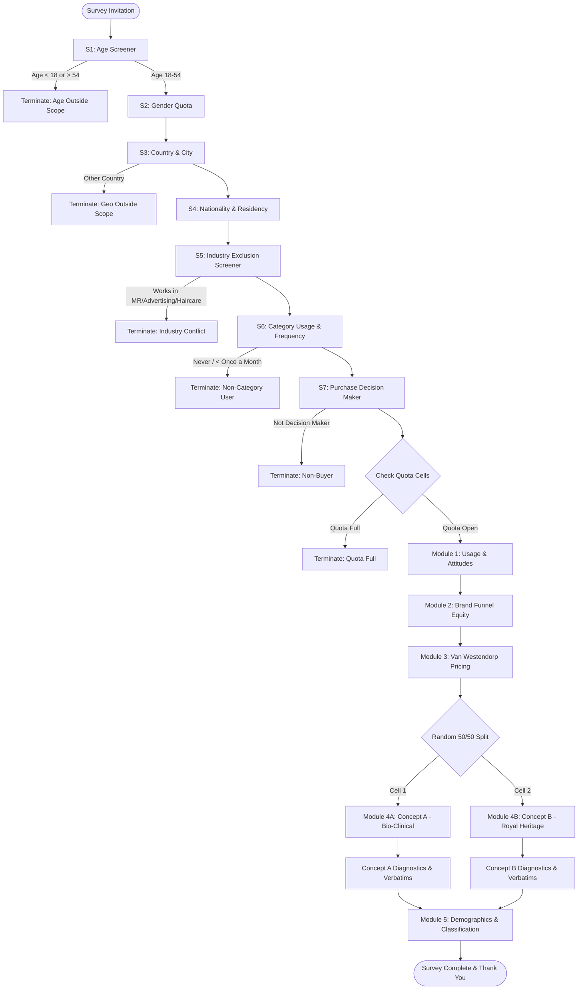

# GCC Consumer Research Kit: Hair & Scalp Care U&A, Brand Funnel, Pricing & Concept Test

**Study Title:** GCC Hair Care & Scalp Therapy Usage & Attitudes (U&A), Brand Equity, Van Westendorp Pricing, and Monadic Concept Test  
**Geographic Coverage:** Kingdom of Saudi Arabia (KSA), United Arab Emirates (UAE), State of Kuwait  
**Target Audience:** Adults aged 18–54, residents of KSA, UAE, or Kuwait, who use hair oil, scalp treatments, or hair serums at least once per month and are primary or joint decision-makers for personal care purchases.  
**Methodology:** Online Quantitative Survey (CAWI - Computer Assisted Web Interviewing), mobile-first responsive design.  
**Survey Duration:** Median length of interview (LOI) = 12 minutes (~1,200 completed interviews post-data cleaning).

---

## 1. Research Objectives & Strategic Context

### 1.1 Business Context
The personal care market in the GCC is undergoing rapid premiumization. Historically dominated by traditional legacy hair oils (e.g., Dabur Amla, Parachute, Bajaj), consumer demand is shifting toward high-performance, clinical, and derm-backed scalp therapies. Simultaneously, local climatic and environmental factors—specifically desalinated hard shower water, high mineral content, severe summer heat, continuous indoor air conditioning, and frequent hair covering (hijab/sheyla)—create acute consumer anxieties regarding hair fall, scalp itchiness, and root weakness.

### 1.2 Core Research Objectives
1. **Usage & Ritual Mapping:** Quantify frequency, occasion, dwell time, application method, and washing routines for hair and scalp treatments across KSA, UAE, and Kuwait.
2. **Environmental & Cultural Pain Points:** Quantify the perceived impact of desalinated hard water, heat, and hijab wear on scalp health and hair loss.
3. **Brand Funnel & Equity:** Measure unaided/aided awareness, trial, past-3-month usage, brand used most often (BUMO), and brand consideration across legacy FMCG and modern prestige/derm brands.
4. **Price Elasticity & Willingness to Pay:** Execute a Van Westendorp Price Sensitivity Meter (PSM) for a premium 100ml bio-active scalp & hair elixir to determine the optimal launch price corridor across SAR, AED, and KWD.
5. **Monadic Concept Testing:** Validate two distinct product positioning concepts in a randomized 50/50 monadic split:
   - *Concept A (Bio-Clinical Scalp Elixir):* High-science, peptide-powered, chelating hard-water defense, ultralight fast-absorbing texture.
   - *Concept B (Royal Heritage Sidr & Black Seed Hair Oil):* Traditional cold-pressed regional botanical authenticity, Habba Sawda, Taif rose/oud infusion, deep nocturnal nourishment.
6. **AI Open-End Coding Benchmark:** Collect rich open-ended verbatims on concept purchase barriers to establish a gold-standard human benchmark dataset for evaluating LLM classification pipelines.

---

## 2. Quota Design & Stratification Matrix

Total Target Sample: **N = 1,200 Clean Completes**

| Market | Share (%) | Target N | Gender Split | Nationality Split |
| :--- | :---: | :---: | :--- | :--- |
| **KSA** (Riyadh, Jeddah, Eastern Prov) | 50.0% | 600 | 65% Female / 35% Male | 70% Saudi National / 30% Arab/Asian Expat |
| **UAE** (Dubai, Abu Dhabi, Sharjah) | 35.0% | 420 | 65% Female / 35% Male | 20% Emirati National / 50% Arab Expat / 30% Western & Asian Expat |
| **Kuwait** (Kuwait City, Hawalli) | 15.0% | 180 | 65% Female / 35% Male | 60% Kuwaiti National / 40% Expat |
| **Total** | **100.0%** | **1,200** | **780 F / 420 M** | **Weighted to Census / Population Benchmarks** |

**Age Quotas per Market:**
- 18–24 years: 20%
- 25–34 years: 40%
- 35–44 years: 25%
- 45–54 years: 15%

---

## 3. Questionnaire Structure & Routing Logic



---

## 4. Master Questionnaire & Survey Programming Specifications

### Screener Module

#### [S1] Age Screener
**Question Text:** Which of the following best describes your age?  
**Question Type:** Single Select (Radio)  
**Variable Name:** `S1_AGE`  
**Responses:**
1. Under 18 `[TERMINATE: S1_AGE_UNDER18]`
2. 18–24 years
3. 25–34 years
4. 35–44 years
5. 45–54 years
6. 55 years or older `[TERMINATE: S1_AGE_OVER54]`
**Programming Spec:** If codes 1 or 6 selected, route to Screen-Out Page 1.

#### [S2] Gender
**Question Text:** Please indicate your gender.  
**Question Type:** Single Select (Radio)  
**Variable Name:** `S2_GENDER`  
**Responses:**
1. Female `[QUOTA: GENDER_F]`
2. Male `[QUOTA: GENDER_M]`

#### [S3] Country & Primary City of Residence
**Question Text:** In which country and city do you currently reside?  
**Question Type:** Single Select (Dropdown)  
**Variable Name:** `S3_LOCATION`  
**Responses:**
*Kingdom of Saudi Arabia:*
101. Riyadh `[QUOTA: KSA]`
102. Jeddah / Makkah Region `[QUOTA: KSA]`
103. Dammam / Khobar / Eastern Province `[QUOTA: KSA]`
104. Other KSA `[QUOTA: KSA]`
*United Arab Emirates:*
201. Dubai `[QUOTA: UAE]`
202. Abu Dhabi `[QUOTA: UAE]`
203. Sharjah / Northern Emirates `[QUOTA: UAE]`
*State of Kuwait:*
301. Kuwait City `[QUOTA: KUWAIT]`
302. Hawalli / Other Kuwait `[QUOTA: KUWAIT]`
*Other:*
999. Other Country `[TERMINATE: S3_GEO_OUT]`

#### [S4] Nationality Status
**Question Text:** What is your nationality?  
**Question Type:** Single Select  
**Variable Name:** `S4_NATIONALITY`  
**Responses:**
1. National Citizen of current country of residence (Saudi / Emirati / Kuwaiti)
2. Arab Expatriate (Egyptian, Lebanese, Jordanian, Syrian, Moroccan, etc.)
3. South Asian Expatriate (Indian, Pakistani, Bangladeshi, etc.)
4. Western / European / North American Expatriate
5. Other Expatriate

#### [S5] Industry Exclusion
**Question Text:** Do you or any member of your immediate household work in any of the following industries?  
**Question Type:** Multi Select (Checkboxes)  
**Variable Name:** `S5_INDUSTRY`  
**Responses:**
1. Market Research, Public Relations, or Advertising `[TERMINATE IF SELECTED]`
2. Cosmetics, Haircare, or Personal Beauty Manufacturing `[TERMINATE IF SELECTED]`
3. Banking, Financial Services, or Insurance
4. Education or Healthcare
5. Retail or E-commerce (Non-beauty)
6. None of the above `[EXCLUSIVE]`  
**Programming Spec:** If Code 1 or Code 2 is selected, terminate interview immediately.

#### [S6] Category Incidence & Frequency
**Question Text:** How frequently do you personally apply hair oil, scalp treatment serums, or leave-in hair therapy products?  
**Question Type:** Single Select  
**Variable Name:** `S6_USAGE_FREQ`  
**Responses:**
1. Daily or almost daily (6–7 times per week) `[QUALIFIED: HIGH FREQ]`
2. 3–5 times per week `[QUALIFIED: HIGH FREQ]`
3. 1–2 times per week `[QUALIFIED: MED FREQ]`
4. 2–3 times per month `[QUALIFIED: LOW FREQ]`
5. Once a month `[QUALIFIED: OCCASIONAL]`
6. Less than once a month `[TERMINATE: S6_LOW_INCIDENCE]`
7. Never `[TERMINATE: S6_NON_USER]`

#### [S7] Purchase Role
**Question Text:** What role do you play in purchasing personal care and hair treatment products for yourself?  
**Question Type:** Single Select  
**Variable Name:** `S7_PURCHASE_ROLE`  
**Responses:**
1. I am the sole decision-maker and make my own purchases `[QUALIFIED]`
2. I am the joint decision-maker (I decide the brand/product together with spouse/family) `[QUALIFIED]`
3. Someone else chooses and purchases products for me `[TERMINATE: S7_NON_BUYER]`

---

### Module 1: Usage & Attitudes (U&A)

#### [Q1] Ritual & Timing of Application
**Question Text:** When and how do you most frequently apply hair oil or scalp treatments?  
**Question Type:** Multi Select (Select all that apply)  
**Variable Name:** `Q1_RITUAL_MOMENTS`  
**Randomize Responses (Keep 99 at bottom):**
1. Overnight treatment (applied before sleep, washed out next morning)
2. Pre-wash intensive bath (applied 30–60 minutes before shower, then shampooed)
3. Post-wash damp hair application (light drop on scalp or ends as leave-in)
4. Dry styling finish (applied to dry hair to tame flyaways, frizz, or add shine)
5. Pre-blow dry / styling heat protectant
6. Post-gym / post-pool scalp refreshment
99. Other (Please specify) `[OPEN-END]`

#### [Q2] Environmental & Lifestyle Stressors (Perceived Scalp Challenges)
**Question Text:** To what extent do you agree that the following environmental or lifestyle factors negatively impact your scalp or hair condition in your country?  
**Question Type:** Grid / 5-Point Agreement Scale  
**Variable Name:** `Q2_STRESSORS_[ITEM]`  
**Scale Points:** 1 = Strongly Disagree, 2 = Disagree, 3 = Neither Agree nor Disagree, 4 = Agree, 5 = Strongly Agree  
**Items (Randomize order):**
- `Q2_1`: Desalinated hard tap water causes mineral buildup and makes my hair brittle
- `Q2_2`: Constant indoor air conditioning dries out my scalp, causing flakes or itchiness
- `Q2_3`: Intense outdoor summer heat and sweat make my scalp greasy at the roots while ends stay dry
- `Q2_4`: Wearing a hijab / sheyla / ghutra for long hours traps heat and leads to scalp sensitivity or root tenderness
- `Q2_5`: Chemical treatments (coloring, bleaching, protein, or keratin) have weakened my hair barrier
- `Q2_6`: Stress and modern work pace cause noticeable hair shedding/thinning

#### [Q3] Key Benefit Drivers
**Question Text:** When shopping for a hair or scalp oil/treatment, what are the top 3 most important benefits you look for?  
**Question Type:** Multi Select (Max 3 Selections)  
**Variable Name:** `Q3_BENEFITS`  
**Validation Rule:** `MAX_SELECTED = 3, MIN_SELECTED = 1`  
**Responses (Randomize):**
1. Reducing hair fall and promoting root density / regrowth
2. Deep hydration and repairing brittle, damaged split ends
3. Lightweight, non-greasy absorption (doesn't leave hair looking limp or oily)
4. Easy to wash out in one shampoo rinse (no sticky residual buildup)
5. Soothing itchy scalp, flaking, or dry dandruff
6. Luxury fragrance that lasts all day (e.g., oud, amber, fresh botanical)
7. 100% natural / clean ingredients with no silicones, sulfates, or parabens
8. Protecting hair against mineral buildup from tap water (chelating protection)

---

### Module 2: Brand Funnel Equity

#### [Q4] Spontaneous (Unaided) Brand Awareness
**Question Text:** When you think of hair oils, scalp serums, and hair treatment brands available in the GCC, which brands come to mind first?  
**Question Type:** Open-End Multi-Box (Up to 3 text boxes)  
**Variable Names:** `Q4_AWAR_TOM` (Top of Mind), `Q4_AWAR_UNAD2`, `Q4_AWAR_UNAD3`  
**Programming Spec:** Text boxes with client-side autocomplete / clean verbatim capture.

#### [Q5] Aided Brand Awareness
**Question Text:** Which of the following brands of hair oils and scalp treatments have you ever heard of?  
**Question Type:** Multi Select  
**Variable Name:** `Q5_AIDED_AWARENESS`  
**Brand List (Randomize, exclude brands mentioned in Q4):**
1. Dabur Amla
2. Parachute (Marico)
3. Vatika (Dabur)
4. Bajaj Almond Drops
5. Kérastase (Elixir Ultime / Chronologiste)
6. Olaplex (No. 7 Bonding Oil)
7. Fable & Mane (HoliRoots Hair Oil)
8. Gisou (Honey Infused Hair Oil)
9. Mielle Organics (Rosemary Mint Scalp & Hair Oil)
10. The Ordinary (Multi-Peptide Serum for Hair Density)
11. Hask Argan Oil
12. Local / Artisanal Apothecary Oil (e.g., Al-Attar, local cold-pressed blends)
99. None of the above `[EXCLUSIVE]`

#### [Q6] Ever Used (Trial)
**Question Text:** Which of these brands have you ever personally used?  
**Question Type:** Multi Select  
**Variable Name:** `Q6_EVER_USED`  
**Filter:** Only show brands selected in `Q4` or `Q5`.

#### [Q7] Past 3 Months Usage
**Question Text:** And which of these brands have you used in the past 3 months?  
**Question Type:** Multi Select  
**Variable Name:** `Q7_P3M_USED`  
**Filter:** Only show brands selected in `Q6_EVER_USED`.

#### [Q8] Brand Used Most Often (BUMO)
**Question Text:** Of the brands you have used in the past 3 months, which ONE brand do you use most often?  
**Question Type:** Single Select (Radio)  
**Variable Name:** `Q8_BUMO`  
**Filter:** Only show brands selected in `Q7_P3M_USED`. If only 1 brand selected in Q7, auto-pipe and skip.

#### [Q9] Brand Consideration Set
**Question Text:** Next time you are looking to purchase a hair oil or scalp treatment, which of the following brands would you seriously consider buying?  
**Question Type:** Multi Select  
**Variable Name:** `Q9_CONSIDERATION`  
**Filter:** Show all brands aided aware (`Q4` or `Q5`).

---

### Module 3: Van Westendorp Price Sensitivity Meter (PSM)

**Context Stimulus Shown to All Respondents:**
> *"Imagine a new 100ml premium, daily bio-active scalp and hair treatment oil formulated specifically for the GCC climate. It strengthens roots, reduces hair shedding, shields against tap-water mineral damage, and absorbs instantly without greasiness."*

**Programming Spec:** Display currency dynamically based on `S3_LOCATION`:
- KSA: Saudi Riyals (SAR)
- UAE: UAE Dirhams (AED)
- Kuwait: Kuwaiti Dinars (KWD)

#### [Q10a] Too Cheap
**Question Text:** At what price for a 100ml bottle would you consider this product to be **so cheap** that you would question its quality and would not buy it?  
**Question Type:** Numeric Open-End  
**Variable Name:** `VW_TOO_CHEAP`  
**Validation Range:** SAR/AED 10 – 600, KWD 1 – 50.

#### [Q10b] Cheap / Good Value
**Question Text:** At what price would you consider this product to be a **bargain / good value**—a great buy for the money?  
**Question Type:** Numeric Open-End  
**Variable Name:** `VW_CHEAP`  
**Validation Rule:** `VW_CHEAP > VW_TOO_CHEAP`

#### [Q10c] Expensive
**Question Text:** At what price would you consider this product to be **expensive**, but you would still consider buying it because of its quality?  
**Question Type:** Numeric Open-End  
**Variable Name:** `VW_EXPENSIVE`  
**Validation Rule:** `VW_EXPENSIVE > VW_CHEAP`

#### [Q10d] Too Expensive
**Question Text:** At what price would you consider this product to be **so expensive** that, regardless of its quality, you would not consider buying it?  
**Question Type:** Numeric Open-End  
**Variable Name:** `VW_TOO_EXPENSIVE`  
**Validation Rule:** `VW_TOO_EXPENSIVE > VW_EXPENSIVE`

---

### Module 4: Monadic Concept Testing (50/50 Split)

**Randomization Instruction:** The survey platform randomly assigns each qualified respondent to either Cell A (`CONCEPT_CELL = 1`) or Cell B (`CONCEPT_CELL = 2`) with equal probability (1:1).

```
+----------------------------------------------------------------------------------------+
| CONCEPT A: "PureDesert Bio-Clinical Scalp Elixir" (Clinical Derm-Tech)                 |
| Headline: High-Performance Derm-Science Tailored for Desert Hair Stress.               |
| Description: Powered by Copper Tri-Peptide-1, Bio-Fermented Rosemary Extract, and     |
| Chelating Mineral Defense. Specifically designed to dissolve hard tap-water calcium   |
| crust on hair follicles, reduce shedding by 72% in 4 weeks, and deliver micro-mist    |
| root absorption with zero greasy residue. Free of silicones and synthetic fragrance.   |
| Pack Size: 100ml Amber Dropper Bottle | Indicative Price: 155 SAR / 150 AED / 12.5 KWD|
+----------------------------------------------------------------------------------------+

+----------------------------------------------------------------------------------------+
| CONCEPT B: "Al-Reem Royal Heritage Sidr & Black Seed Hair Oil" (Botanical Heritage)    |
| Headline: Royal Khaleeji Hair Apothecary Re-Imagined for Modern Elegance.             |
| Description: Crafted from first-press Yemeni Royal Sidr Leaf Oil, Ethiopian Black Seed |
| (Habba Sawda), and cold-pressed Sweet Almond Oil, subtly infused with Taif White Rose  |
| and sheer Amber. Rejuvenates compromised scalp barriers, restores mirror shine to dry |
| strands, and leaves an intoxicating scent that lingers under your sheyla all day long. |
| Pack Size: 100ml Heavyweight Glass Flacon | Indicative Price: 155 SAR / 150 AED / 12.5|
+----------------------------------------------------------------------------------------+
```

#### [Q11] Monadic Purchase Intent (Primary KPI)
**Question Text:** Having read about this product, how likely would you be to purchase it if it were available at this price in your favorite beauty retailer (e.g., Sephora, Bath & Body Works, Boots, Nahdi, or online on Amazon/Noon)?  
**Question Type:** Single Select (5-Point Purchase Intent Scale)  
**Variable Name:** `Q11_PURCHASE_INTENT`  
**Responses:**
5. Definitely would buy `[TOP-BOX]`
4. Probably would buy `[TOP-2-BOX with Code 5]`
3. Might or might not buy
2. Probably would not buy
1. Definitely would not buy

#### [Q12] Concept Diagnostic Battery
**Question Text:** Based on the description you just read, please rate how well each of the following statements applies to this product:  
**Question Type:** Grid / 5-Point Scale  
**Variable Name:** `Q12_DIAG_[ITEM]`  
**Scale Points:** 1 = Poor / Not at all, 2 = Fair, 3 = Good, 4 = Very Good, 5 = Excellent  
**Items:**
- `Q12_UNIQUENESS`: Uniqueness (Different from other hair products on the market)
- `Q12_RELEVANCE`: Relevance to my personal hair & scalp needs
- `Q12_BELIEVABILITY`: Believability of the claims made
- `Q12_VALUE_FOR_MONEY`: Value for money at the indicated price point
- `Q12_BRAND_FIT`: Appeal of the brand name and packaging aesthetic

#### [Q13] Open-Ended Likes (Verbatim)
**Question Text:** What, if anything, did you **like most** about this product concept? Please be as detailed as possible.  
**Question Type:** Text Open-End  
**Variable Name:** `Q13_VERBATIM_LIKES`  
**Validation Rule:** `MIN_CHARACTERS = 15`

#### [Q14] Open-Ended Dislikes & Purchase Barriers (Target for AI Coding Benchmark)
**Question Text:** What, if anything, do you **dislike**, find unconvincing, or what would **prevent you from purchasing** this product? If nothing, please explain what would make it even better.  
**Question Type:** Text Open-End  
**Variable Name:** `Q14_VERBATIM_BARRIERS`  
**Validation Rule:** `MIN_CHARACTERS = 10`

---

### Module 5: Demographics & Classification

#### [D1] Monthly Household Income
**Question Text:** Which of the following ranges best represents your total monthly household income?  
**Question Type:** Single Select  
**Variable Name:** `D1_HH_INCOME`  
**Responses (Dynamic Currency by Country):**
*KSA (SAR) / UAE (AED):*
1. Under 10,000 SAR/AED
2. 10,000 – 19,999 SAR/AED
3. 20,000 – 34,999 SAR/AED
4. 35,000 – 49,999 SAR/AED
5. 50,000 SAR/AED or more
99. Prefer not to disclose

*Kuwait (KWD):*
1. Under 800 KWD
2. 800 – 1,599 KWD
3. 1,600 – 2,799 KWD
4. 2,800 – 3,999 KWD
5. 4,000 KWD or more
99. Prefer not to disclose

#### [D2] Marital & Household Status
**Question Text:** What is your marital status?  
**Question Type:** Single Select  
**Variable Name:** `D2_MARITAL_STATUS`  
**Responses:**
1. Single / Never married
2. Married without children
3. Married with children living at home
4. Other

#### [D3] Hair Covering Practice (Female Respondents Only)
**Question Text:** In your everyday public life, how frequently do you cover your hair (e.g., hijab, sheyla, abaya hood)?  
**Question Type:** Single Select  
**Variable Name:** `D3_HAIR_COVERING`  
**Filter:** Ask only if `S2_GENDER == 1 (Female)`  
**Responses:**
1. Always (Daily in public)
2. Frequently (Most days)
3. Occasionally / Sometimes
4. Never

---

## 5. Summary Programming Data Dictionary

| Variable | Question Type | Format | Routing / Filter Rule | Validation Check |
| :--- | :--- | :--- | :--- | :--- |
| `RESP_ID` | System ID | Numeric (7-digit) | Generated on landing | Unique across all submissions |
| `LOI_SECONDS` | System Timer | Numeric | Auto-timed total duration | Flag if < 240s (Speeding) |
| `DEVICE_TYPE` | System | Categorical | Mobile / Desktop / Tablet | None |
| `S1_AGE` | Single Select | Categorical (1-6) | All respondents | Terminate if 1 or 6 |
| `S2_GENDER` | Single Select | Categorical (1-2) | All respondents | Quota target check |
| `S3_LOCATION` | Single Select | Categorical (101-999) | All respondents | Terminate if 999 |
| `S4_NATIONALITY` | Single Select | Categorical (1-5) | All respondents | Quota stratification |
| `S5_INDUSTRY` | Multi Select | Binary string | All respondents | Terminate if 1 or 2 |
| `S6_USAGE_FREQ` | Single Select | Categorical (1-7) | All respondents | Terminate if 6 or 7 |
| `S7_PURCHASE_ROLE` | Single Select | Categorical (1-3) | All respondents | Terminate if 3 |
| `Q1_RITUAL_MOMENTS` | Multi Select | Binary dummy (1/0) | All qualified | Max 6 selections |
| `Q2_STRESSORS_1..6` | Grid (1-5) | Numeric (1-5) | All qualified | Straight-lining check (StdDev == 0) |
| `Q3_BENEFITS` | Multi Select | Binary dummy (1/0) | All qualified | Max 3 selections enforced |
| `Q4_AWAR_TOM` | Open-End Text | String | All qualified | Autocomplete / verbatim |
| `Q5_AIDED_AWAR` | Multi Select | Binary dummy (1/0) | All qualified | Exclusive 'None' logic |
| `Q6_EVER_USED` | Multi Select | Binary dummy (1/0) | Piped from Q4/Q5 aware | Must be subset of Aware |
| `Q7_P3M_USED` | Multi Select | Binary dummy (1/0) | Piped from Q6 ever used | Must be subset of Ever Used |
| `Q8_BUMO` | Single Select | Categorical (1-12) | Piped from Q7 P3M used | Must be one of P3M brands |
| `Q9_CONSIDERATION` | Multi Select | Binary dummy (1/0) | Piped from Q4/Q5 aware | Must be subset of Aware |
| `VW_TOO_CHEAP` | Numeric Open | Numeric | All qualified | Range 10-600 SAR/AED |
| `VW_CHEAP` | Numeric Open | Numeric | All qualified | `VW_CHEAP > VW_TOO_CHEAP` |
| `VW_EXPENSIVE` | Numeric Open | Numeric | All qualified | `VW_EXPENSIVE > VW_CHEAP` |
| `VW_TOO_EXPENSIVE`| Numeric Open | Numeric | All qualified | `VW_TOO_EXPENSIVE > VW_EXPENSIVE` |
| `CONCEPT_CELL` | System Random | Categorical (1=A, 2=B) | 50/50 Monadic split | Balanced allocation |
| `Q11_PURCHASE_INT`| Single Select | Numeric (1-5) | Cell A or Cell B | Top-2-Box calculation |
| `Q12_DIAG_1..5` | Grid (1-5) | Numeric (1-5) | Cell A or Cell B | Diagnostic profile |
| `Q13_VERB_LIKES` | Open-End Text | String | Cell A or Cell B | Min length 15 characters |
| `Q14_VERB_BARRIER`| Open-End Text | String | Cell A or Cell B | AI coding validation target |
| `D1_HH_INCOME` | Single Select | Categorical (1-5, 99) | All qualified | Demographic cut |
| `D2_MARITAL` | Single Select | Categorical (1-4) | All qualified | Demographic cut |
| `D3_HAIR_COVER` | Single Select | Categorical (1-4) | Female respondents only | Skipped if Gender == Male |
